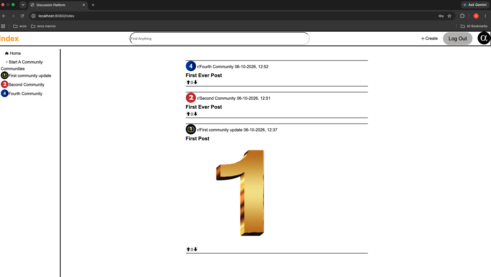
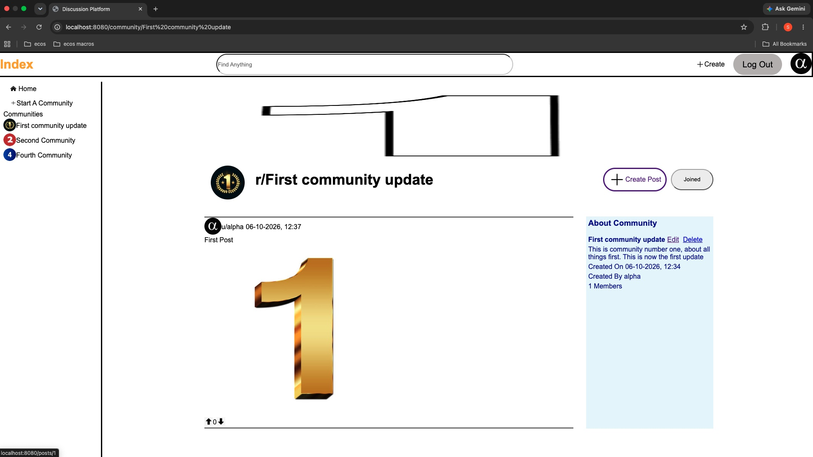
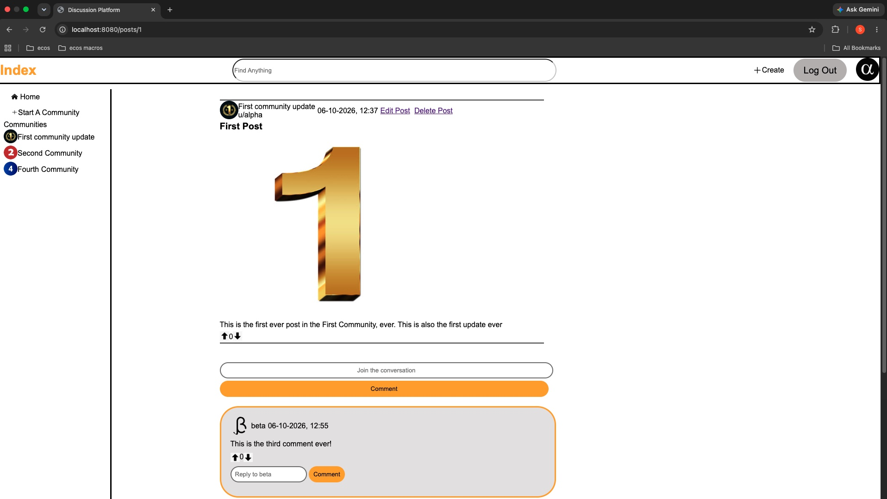
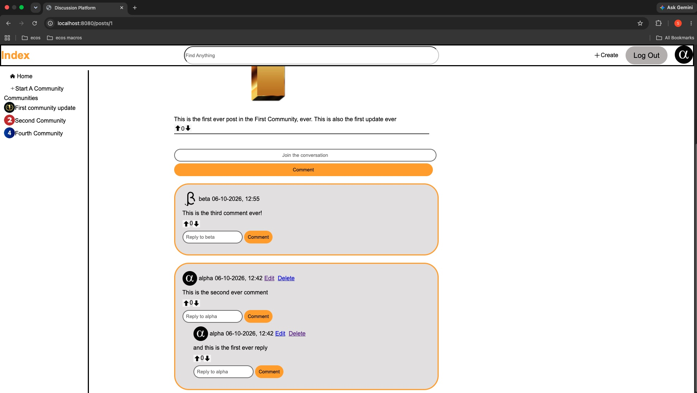
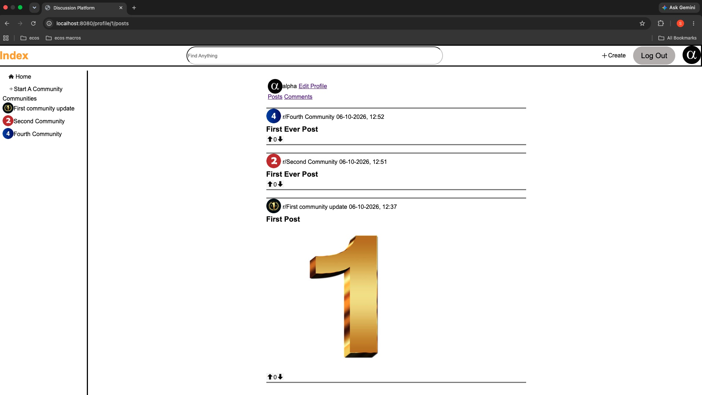
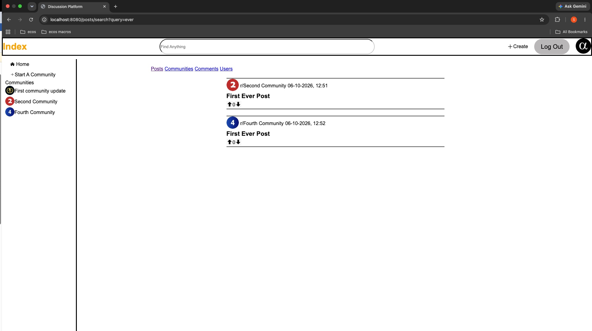

Discussion Platform By Philip Musoke

# Overview

Discussion Platform is a Reddit-inspired discussion web application developed using Java and Spring Boot.

The application allows users to create and join communities centred around topics of interest, publish posts, participate in discussions through comments and nested replies, and interact with content through an upvote and downvote system. 

Users can also personalise their experience through a feed displaying posts from communities they have joined, manage their profiles, and search for posts, communities, comments and other users. 


## Features

### Authentication and User Profiles
- User registration, login and logout
- Profile viewing and editing
- User-specific posts and comments
- Ownership-based restrictions on editing and deleting content

### Communities
- Create, edit, and delete communities
- Join and leave communities
- View community information and membership counts
- Browse posts belonging to individual communities

### Posts and Discussions
- Create, edit and delete posts
- Add optional images to posts
- Comment on posts
- Reply to comments through nested discussion threads
- Edit and delete comments
- Upvote and downvote posts and comments

### Feeds and Search
- Browse posts from all communities on the Index page
- View a personalised feed based on joined communities
- Search for posts, communities, comments and users


## Tech Stack
- Java
- Spring Boot
- Spring MVC
- Spring Security
- Spring Data JPA / Hibernate
- Thymeleaf
- MySQL
- HTML
- CSS
- Maven


## Application architecture

The discussion platform follows a layered architecture, separating the handling of HTTP requests, application logic and database operations.

The application's general request flow is:

HttpRequest -> Controller -> Service -> Repository -> MySQL Database

### Controllers
The Controller classes serve the purpose of handling incoming Http requests, interacting with relevant service classes and determining which Thymeleaf templates should be rendered in response. 

### Services
The Service classes serve the purpose of holding the application's business logic. The operations they process include creating posts, managing community memberships , the handling of votes and the updates to user information

### Repository
The Repository interface serves the purpose of using Spring Data JPA to provide an abstraction between the service layer and the underlying database. 

They handle the database operations, these being: retrieving, saving and deleting entities, including queries for specific application requirements.

### MySQL Database
MySQL is used as the application's relational database

Information stored includes users, communities, memberships, posts, comments and votes as well as the relationships between these entities.

### Data Transfer Objects (DTOs) and Mappers
DTOs are used to transfer data across different parts of the application. 

Mapper classes serve the purpose of conversion between JPA entities and their corresponding DTOs, which allows the application to separate its database entities from the data representations used by other layers


### View Layer
Thymeleaf templates, along with HTML and CSS are used to render the application's user interface.

Controllers provide the data needed by these templates, which gets displayed to users in their browsers.

## Screenshots

### Index Page


### Community Detail Page


### Post Detail Page



### User Profile Page


### Search Results Page(searching term "ever")



## Installation and Running Locally
### Requirements
The following needs to be installed:
- Java Development Kit(JDK) 21
- MySQL Server
- Git
- Maven(if not using the Maven Wrapper)

1. Clone the Repository

Clone the repository then navigate to the projects directory:

```
git clone https://github.com/pmusoke/discussion-platform.git
cd discussion-platform
```

2. Create the MySQL Database


Start your MySQL server then execute the following SQL statement:

```
CREATE DATABASE redditvtwo;
```

3. Configure the Database Connection

Configure the database connection in src/main/resources/application.properties.

eg:

```
spring.application.name=web

spring.datasource.url=jdbc:mysql://localhost:3306/redditvtwo
spring.datasource.username=${DB_USERNAME}
spring.datasource.password=${DB_PASSWORD}

spring.jpa.hibernate.ddl-auto=update
```

Set the DB_USERNAME and DB_PASSWORD environment variables to the credentials of a MySQL account with access to the database. 

eg (For macOS/Linux):

```
export DB_USERNAME=root
export DB_PASSWORD="your_mysql_password"
```

Hibernate is configured to update the database schema when the application starts. 

4. Run the Application 

For macOS/Linux, in the project root directory, run:

```
./mvnw spring-boot:run 
```

For Windows, in the project root directory, run:

```
./mvnw.cmd spring-boot:run
```


If Maven is globally installed:

```
mvn spring-boot:run
```

5. Access the Application 

Once the application has started, open the browser, then navigate to:

http://localhost:8080

Register a user account and begin using the application


## What I Learned
This web application provided me with practical experience in building a full stack web application using Java and Spring Boot.

Throughout the project, I gained experience in:

- Spring MVC: Handling HTTP requests, processing form submissions, passing data to views using models, and implementing redirects. 
- Layered Architecture: Organising the application into controller, service and repository layers, each layer having its own responsibilities
- Spring Data JPA and Hibernate: Working with entities, repositories and relationships to retrieve and persist data in a MySQL database.
- Spring Security: Implementing user authentication and authorisation, including restricting the editing and deletion of content to its creator
- DTOs and Mappers: Separating the data transferred between application layers from the underlying database entities
- Thymeleaf, HTML and CSS: Developing dynamic web pages, rendering data from the backend, processing forms and styling the user interface.
- Validation: Validating user inputs and handling errors during form submissions. 
- Debugging and Testing: Identifying and resolving issues through manual testing, including testing interactions between multiple user accounts.

The project gave me experience in implementing application specific functionality such as nested comments, voting, community memberships and personalised feeds. 


## Web Pages

### Index Page
On the index/landing page, the user will see a list of all the posts which have been made, in ascending order in terms of the date. This page is divided into 3 parts,
that being the top panel, the left panel and the main content. The top panel and left panel are present in all pages, with the main content differing across pages

#### The top panel:
- Index button, which takes users to the Index page 
- "Find Anything" search bar, which allows users to search for:
    - Posts
    - Communities
    - Comments 
    - Users
- When logged out, The Log In button, which takes the user into the Log In page
- When logged out, The Sign Up button, which takes the user into the registration page
- When logged in, the Create button, which takes the user to the create a post page
- When logged in, the Log Out button, which logs the user out of the session 
- When logged in, the users profile picture as a button, which takes the user to the user's profile detail page

The left panel:
- When logged in, the Home button, which takes the user to their personal feed, which shows all the posts of the communities that the user is a member of. 
- When logged in, the Start a Community button, which takes the user to the Create a Community page
- When logged in, the list of communities that the user is a member of

#### The main content:

The list of all the posts which have been made. For each post made, the following is presented:
- The Community profile picture. This is also a link to the community detail page of the relevant community
- The Community name. This is also a link to the community detail page of the relevant community
- The Post title. This also serves as a link to Post Detail page of the relevant post
- The Post picture(if included). This also serves as a link to the Post Detail page of the relevant post
- An upvote button 
- The net number of votes a post has 
- A downvote button


### Register Page
This consists of the registration form used to create a user. The required information to create a user includes:
- Username
- Email
- Password
- Photo URL

### Log In Page
This consists of the sign-in form used to log the user into the web application. The required information includes:
- Username
- Password

### Home Page
The main content of this page is list of all the posts which have been made, filtered for posts belonging to communities that the user is a member of. This view
is only available when logged in. For each post made, the following is presented:
- The Community profile picture. This is also a link to the community detail page of the relevant community
- The Community name. This is also a link to the community detail page of the relevant community
- The Post title. This also serves as a link to Post Detail page of the relevant post
- The Post picture(if included). This also serves as a link to the Post Detail page of the relevant post
- An upvote button 
- The net number of votes a post has 
- A downvote button


### Create a Community Page
The main content of this page consists of the form used to create a new Community. The required information includes:
- Name
- Description
- Community Picture URL(optional)
- Banner Image URL(optional)

### Create a Post Page
The main content of this page consists of the form used to create a new Post. The required information includes:
- The selected community from a drop down of available communities
- The title
- Description
- Photo URL

### Profile Detail Page - Posts
The main content of this page consists of the user detail, mainly, the list of all the posts made by the user. For each post made, the following is presented:
- The Community profile picture. This is also a link to the community detail page of the relevant community
- The Community name. This is also a link to the community detail page of the relevant community
- The Post title. This also serves as a link to Post Detail page of the relevant post
- The Post picture(if included). This also serves as a link to the Post Detail page of the relevant post
- An upvote button 
- The net number of votes a post has 
- A downvote button

### Profile Detail Page - Comments
The main content of this page consists of the user detail, mainly, the list of all the comments made by the user. If the user is viewing their own profile, an edit link is available for them, which takes the user to the edit profile page. For each post made, the following is presented:
- The Community profile picture. This is also a link to the community detail page of the relevant community
- The Community name. This is also a link to the community detail page of the relevant community
- The Comment. This also serves as a link to Post Detail page of the relevant post that the comment belongs to
- An upvote button 
- The net number of votes a post has 
- A downvote button

### Post Detail Page
The main content of this page consists of the relevant Post detail. If the user is viewing a post that the user themselves made, "Edit Post" and "Delete Post" 
will be available to the user. The Post detail presents the following:
- The Community profile picture. 
- The Community name
- The username of the post creator
- When the Post was created 
- The Post title 
- The Post content
- The Post picture if applicable 

There is also an Input button which allows the user to leave a comment on a Post.

Below the Comment button, the list of all the Post's Comments will be presented. For each comment, the following is presented:
- The creator of the Comment's profile picture
- The creator of the Comment's name
- The date the Comment was created 
- If the user created the comment, options to Edit or Delete the Comment
- The Comment content itself 
- An upvote button
- The net number of votes a Comment has 
- A downvote button
- An input box to type in a reply to the Comment, and the reply button
- All of nested replies to the Comment


### Community Detail Page
The main content of the Community detail page consists of details relating to the Community, such as its banner image; the Community photo URL; the Community name;
The button to Create a Post; the button to Join or Unjoin the community; the list of all the Posts belonging to the Community and for each post, the following 
is presented:
- The creator of the Post profile picture
- The creator of the Post's username 
- When the Post was created 
- The title of the Post 
- An upvote button
- The net number of votes the Post has 
- A downvote button

The main content also contains an About Community block, which presents:
- The Community name
- If the user created the Community, the option to Edit or Delete the community
- The Community description
- When the Community was created 
- Who the Community was created by
- How many members are in the Community

### Edit Profile Page
The main content of the Edit Page consists of the form used to edit the users profile. The required information to edit a user's profile includes:
- The email
- The Photo URL

### Edit Community Page
The main content of the Edit Community Page consists of the form used to edit the Community. The required information to edit a community includes:
- Name
- Description
- Picture URL
- Community Picture Header URL

### Edit Post Page
The main content of the Edit Post Page consists of the form used to edit the Post. The required information to edit a Post includes:
- Title
- Description
- Photo URL

### Edit Comment Page
The main content of the Edit Comment Page consists of the form used to edit the Comment. The required information to edit a Comment includes:
- Comment


